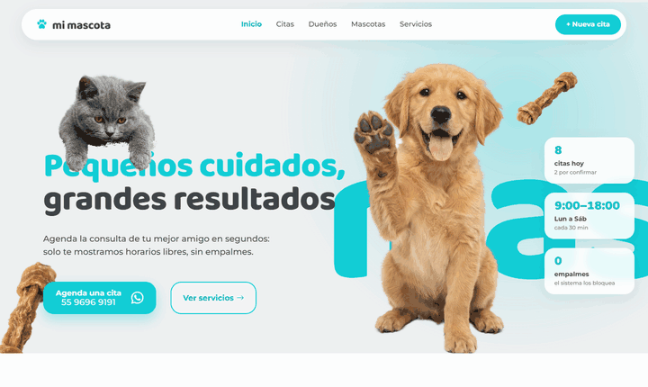
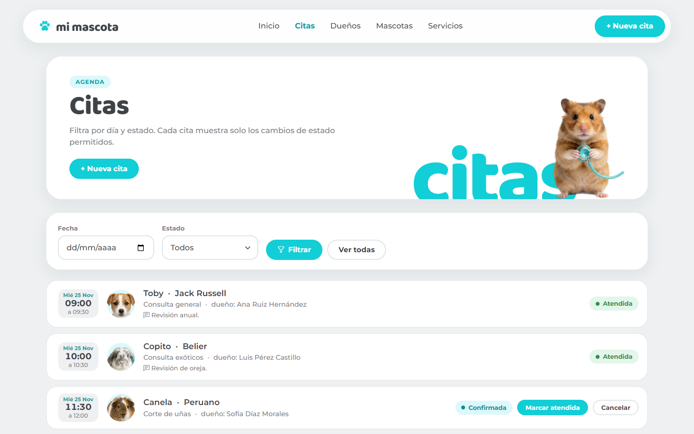
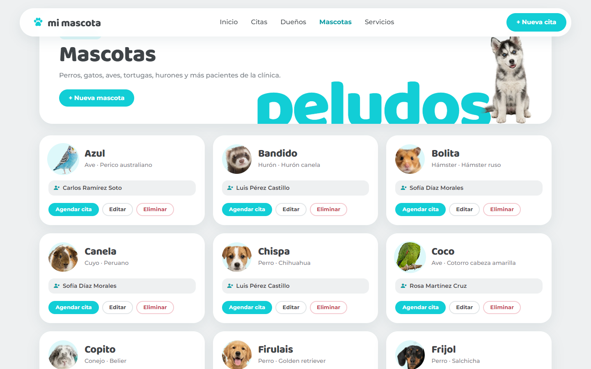
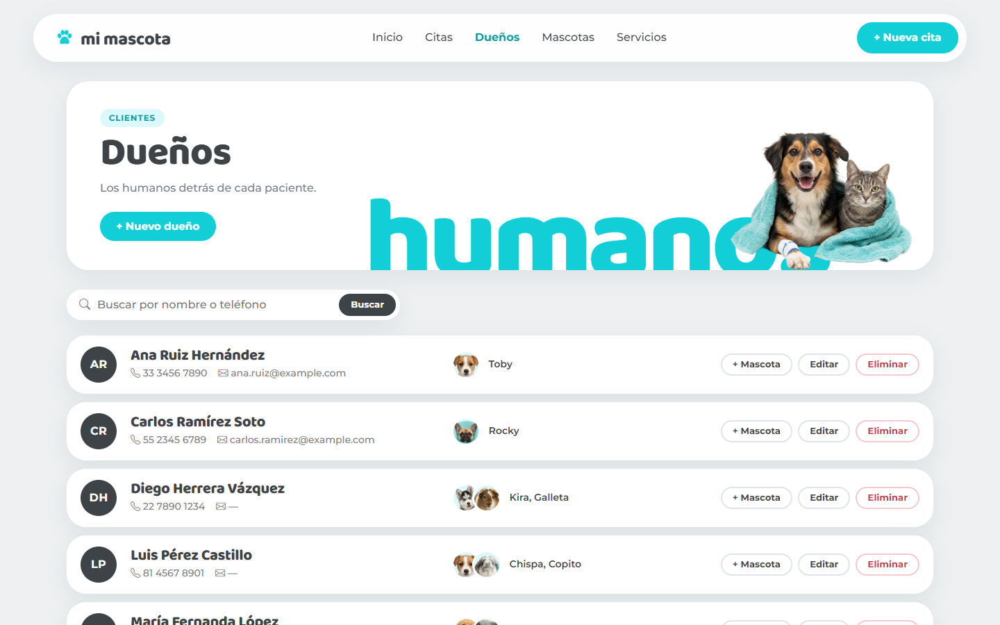
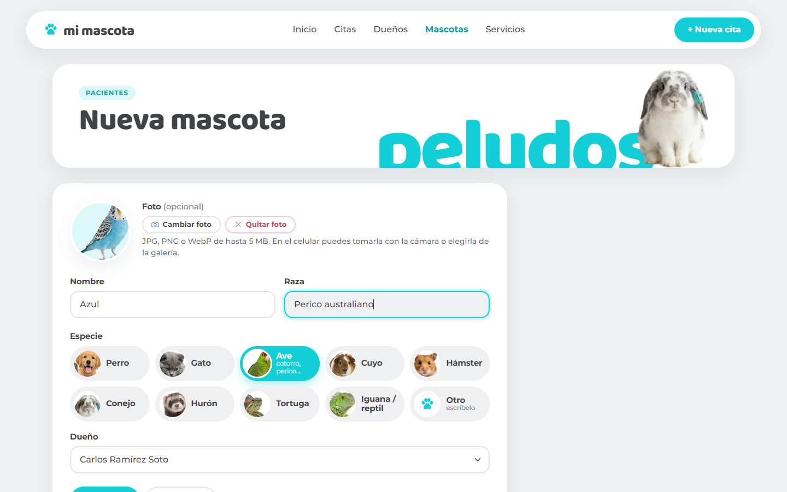
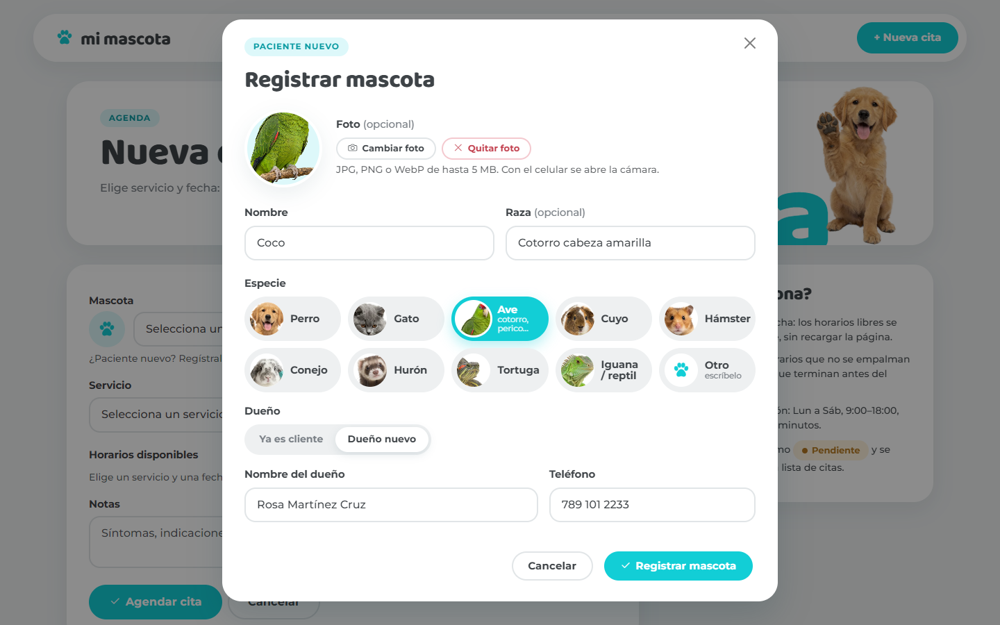
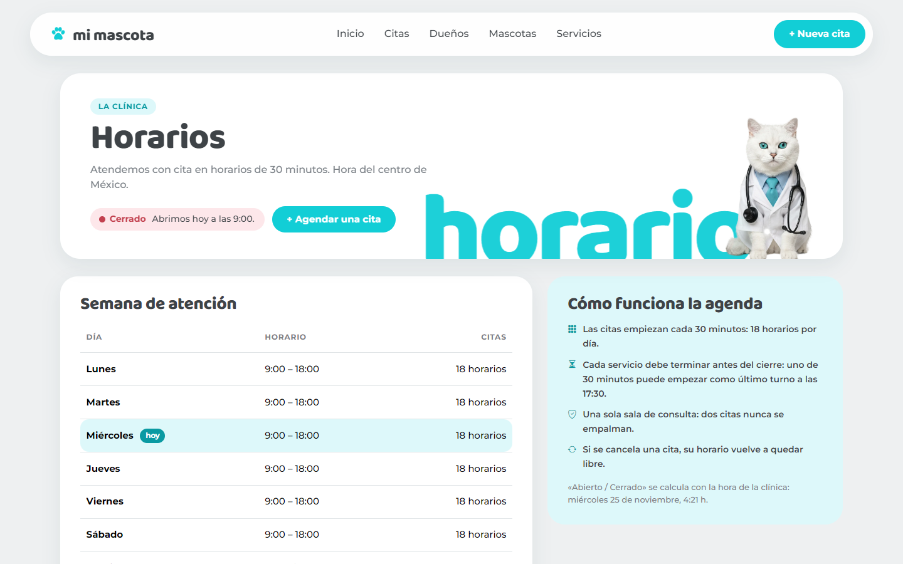
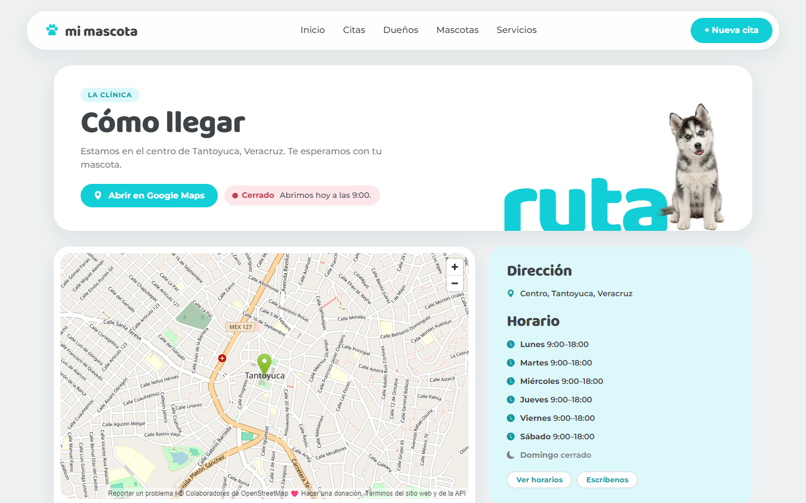
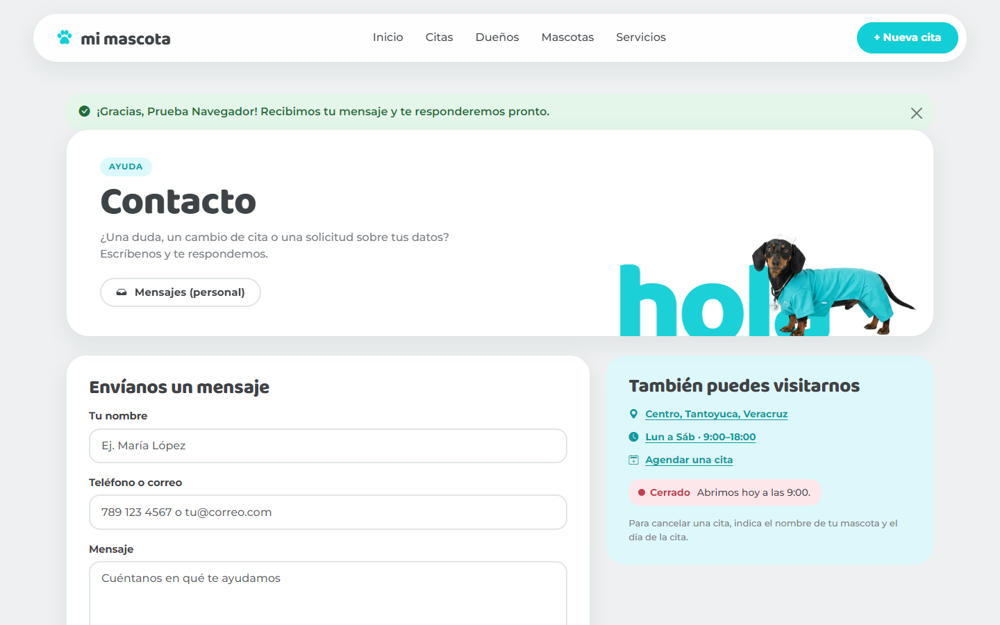
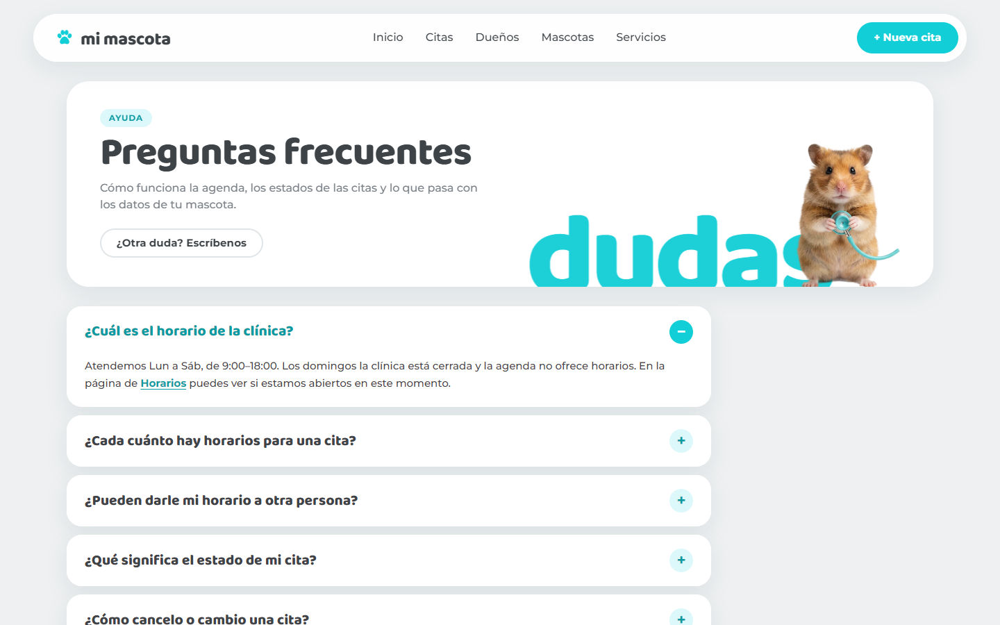

# Mi Mascota · Veterinary appointment booking


Appointment booking system for **Mi Mascota**, a small veterinary clinic in Tantoyuca, Veracruz. The demo data (owners, pets, appointments) is fictional. Staff register pet owners and their pets, keep a catalog of services, and book appointments on a calendar grid that only offers free time slots. Each appointment then moves through a controlled workflow: **Pendiente → Confirmada → Atendida**, or **Cancelada**.

**Stack:** C# · ASP.NET Core 9 MVC (Razor views) · Entity Framework Core 9 · SQL Server (SQLite for local runs) · SkiaSharp (photo processing) · Bootstrap 5 · jQuery/AJAX · xUnit

The UI is in Spanish (the clinic's language). The code is in English.

## Features

- **Owners, pets and services**: CRUD with server-side and client-side validation. Records that are still in use can't be deleted (an owner with pets, a pet or service with appointments); the app explains why.
- **Appointments**: list filtered by date and status, plus one button for each status the appointment can move to next.
- **Dynamic availability**: in the booking form, choosing a service and a date calls `GET /Appointments/Availability` with jQuery AJAX. The free slots come back as JSON and are drawn as buttons, with no page reload.
- **Any kind of patient**: the pet form has a species picker with illustrated chips (Perro, Gato, Ave, Cuyo, Hámster, Conejo, Hurón, Tortuga, Iguana / reptil, and *Otro* with a free-text field). Species is still stored as text, so nothing is lost for unusual pets.
- **Pet photos**: staff can take a photo with the phone camera or pick one from the gallery, see it right away in a round preview (FileReader), replace it or remove it. The server accepts JPG, PNG or WebP up to 5 MB and checks the real type by its magic bytes. It then decodes the whole image with SkiaSharp (corrupt or truncated files are rejected), applies the camera orientation, scales it to 1000 px max and saves it as WebP **without metadata**, so the GPS location that phones store in EXIF is never kept. Files get a random name (`wwwroot/uploads/mascotas/{guid}.webp`) and the old file is deleted when the photo is replaced or removed and when the pet is deleted. The photo replaces the illustration everywhere the pet appears (agenda, appointments, pets, owners, booking form).
- **Register a pet while booking**: "Registrar mascota nueva" in *Nueva cita* opens a modal (species chips, name, breed, existing owner or a new owner with name and phone, optional photo). It posts `multipart/form-data` with the antiforgery token to `POST /Pets/QuickCreate` via `fetch`; the server validates with the same rules as the full forms and returns Spanish errors as JSON, or the new pet, which is added to the drop-down and selected without reloading the page.
- **Double-booking protection**: the server checks the slot again before saving. If it overlaps another appointment, the form shows a descriptive message, e.g. *"El horario 12:30–13:30 ya está ocupado: se empalma con la cita de Rocky (Baño y estética, 13:00–14:00)."*
- **Controlled state changes**: invalid transitions are rejected with a Spanish message that explains why.
- **Clinic pages from the footer**: every footer link works. One `ClinicController` serves friendly Spanish routes: `/clinica/nosotros` (story, values and the team cards, shared with the home page as the `_Team` partial and its `#equipo` anchor), `/clinica/horarios` (weekly table built from the `Clinic` settings with slots per day and an **Abierto ahora / Cerrado** badge), `/clinica/como-llegar` (address, hours, an embedded OpenStreetMap centered on Tantoyuca and an "Abrir en Google Maps" link), `/ayuda/preguntas` (accordion answered from the real rules: hours, 30-minute grid, no double booking, the status flow, exotic pets, photo EXIF/GPS removal, cancelling), `/ayuda/terminos` and `/ayuda/privacidad` (plain-language terms and a privacy notice in the spirit of the LFPDPPP, with ARCO requests through the contact page).
- **Open now, in the clinic's time zone**: `ClinicHours` converts "now" to `America/Mexico_City` (configurable as `Clinic:TimeZoneId`, falling back to the Windows id and then to UTC-6), so the badge is right whatever zone the server runs in. It also explains the next opening ("Abrimos mañana a las 9:00", "Abrimos el lunes a las 9:00").
- **Footer service links**: "Consulta general", "Vacunas", "Baño y estética" and "Exóticos" open *Nueva cita* with the service preselected (`/Appointments/Create?serviceId=…`). A view component matches them by service name when the page renders; if a service was renamed or deleted, the link goes to the services list instead.
- **Contact form and staff inbox**: `/contacto` takes a name, a phone or e-mail (one field, one regex shared by the browser and the server) and a message, with antiforgery and Post/Redirect/Get. Messages are saved in a `ContactMessages` table; `/contacto/mensajes` lists them newest first and marks them as read. Social networks without an account are shown as non-link icons with the title "Próximamente"; WhatsApp goes to the contact page.
- **Demo data**: 8 owners, 19 pets (dogs of six breeds, cats, guinea pigs, hamsters, rabbits and exotic patients: Paco the cotorro, Kiwi the perico australiano, Manuelita the turtle, Rex the iguana and Bandido the ferret), 6 services and 17 appointments on today and the next open day, covering all four statuses.

## Screenshots

**Hero animation** (the puppy gives its paw, the kitten blinks):



**Inicio** (landing + the real agenda of the day, full page):


| Citas | Nueva cita (slots loaded via AJAX) |
|---|---|
|  |  |

| Mascotas (exotic pets and uploaded photos) | Dueños |
|---|---|
|  |  |

| Pet form (species chips + photo preview) | Registering a pet from Nueva cita |
|---|---|
|  |  |

| Horarios (open/closed badge, weekly table) | Cómo llegar (OpenStreetMap) |
|---|---|
|  |  |

| Contacto (after sending a message) | Preguntas frecuentes |
|---|---|
|  |  |

| Servicios | Inicio on mobile (390 px) |
|---|---|
|  |  |

## Diseño

The UI follows a design made in Figma for this project ("Mi Mascota · Inicio"): a playful clinic landing page whose panels show the real system data.

- **Tokens** (CSS variables in `wwwroot/css/site.css`): turquoise `#12CED6` for fills, giant words and calls to action; deep turquoise `#0A9AA2` for turquoise text on light backgrounds; ink `#3E4347`; page `#EEF0F1`; muted `#7A8086`; footer `#1E2A2E`. Each status has its own badge colors (Pendiente amber, Confirmada turquoise, Atendida green, Cancelada red). Pill buttons, cards with 22–32 px radius and a soft shadow.
- **Fonts**: *Baloo 2* ExtraBold for headings, the logo and the giant background words; *Montserrat* 500/600/700 for text. Both are self-hosted in `wwwroot/fonts` (no font CDN), and so are the Bootstrap Icons.
- **Real data in the landing**: the hero cards show today's appointments and how many are still pending, plus the opening hours from `appsettings.json`. "Agenda de hoy" lists today's appointments with the same state-transition buttons as the list. "Nueva cita rápida" calls `GET /Appointments/Availability` for the grooming service on the next open day, draws taken slots struck through and links to the booking form with the slot preselected. The bath banner reads the price and duration of the "Baño y estética" service.
- **Pet avatars**: the pet's own photo when it has one; otherwise `PetAvatar` picks an illustration from the species and breed (perro → breed-specific dog, gato, cuyo, hámster, conejo, ave → cotorro or perico, hurón, tortuga, iguana/reptil), so every list shows a face.
- **Animations** (CSS + a little vanilla JS, all disabled with `prefers-reduced-motion`): the golden puppy really gives its paw (three photo frames of the same puppy, paw up / half / down, swapped stop-motion style), the kitten rises from behind the headline, bobs and blinks (a closed-eyes version of the same photo laid on top), the bones float, giant words slide in from the right, the "todos" pets hop one after another when the section scrolls into view (`IntersectionObserver`), team cards lift on hover and the hero numbers count up.
- **Images**: generated with Figma AI; the animation frames (paw half/down, closed eyes) were edited from the same photos with OpenAI's image model so only the paw or the eyes change. Backgrounds removed with rembg, converted to WebP. See [docs/CREDITS.md](docs/CREDITS.md).

## Domain rules

### Appointment state machine

| From \ To      | Pendiente | Confirmada | Atendida | Cancelada |
|----------------|:---------:|:----------:|:--------:|:---------:|
| **Pendiente**  | –         | ✅ ¹       | ❌       | ✅        |
| **Confirmada** | ❌        | –          | ✅       | ✅        |
| **Atendida**   | ❌        | ❌         | –        | ❌        |
| **Cancelada**  | ❌        | ❌         | ❌       | –         |

¹ An appointment whose start time has already passed can't be confirmed.

New appointments always start as **Pendiente**. *Atendida* and *Cancelada* are final states. Every rejected change returns a specific message, for example:

- Pendiente → Atendida: *"No se puede marcar como atendida una cita pendiente: primero debe confirmarse."*
- Atendida → anything: *"La cita ya fue atendida; su estado ya no puede cambiar."*
- Cancelada → anything: *"La cita está cancelada; su estado ya no puede cambiar…"*

The rules live in a single place, [`AppointmentStateMachine`](src/MiMascota.Web/Services/AppointmentStateMachine.cs). The service uses it to validate a change, and the list view uses it to decide which buttons to show.

### Availability and booking rules

| Rule | Detail |
|---|---|
| Opening hours | 09:00–18:00, Monday to Saturday (configurable) |
| Grid | Appointments start every 30 minutes (configurable) |
| Duration | Each service has its own duration. A slot is only offered if the whole service ends by closing time (a 90-minute service's last slot is 16:30). |
| Overlaps | One consultation room: no two active appointments can overlap. Two ranges overlap when `a.Start < b.End && a.End > b.Start`, so back-to-back appointments are allowed. |
| Cancelled | A cancelled appointment frees its slot. |
| Closed days | Sundays return *"La clínica no abre los domingos."* |
| Past | No past dates, and on the current day no slot that has already started. |

The hours are set in `appsettings.json`:

```json
"Clinic": {
  "OpeningTime": "09:00",
  "ClosingTime": "18:00",
  "SlotMinutes": 30,
  "ClosedDays": [ "Sunday" ],
  "TimeZoneId": "America/Mexico_City"
}
```

## Architecture

```
Browser (Razor views + Bootstrap + jQuery)
        │  HTTP / AJAX (JSON)
        ▼
Controllers ── thin: bind input, call a service, choose a view/redirect
        │
        ▼
Services ──── business rules, return Result / Result<T> (no exceptions for rule violations)
  ├─ AvailabilityService   free slots for a date + service
  ├─ AppointmentService    booking with overlap check, status changes
  ├─ AppointmentStateMachine  allowed transitions + Spanish messages
  ├─ ClinicSchedule        opening hours, closed days, slot grid (pure logic)
  └─ ClinicHours           "Abierto ahora / Cerrado" and the weekly table, in the clinic's time zone
        │
        ▼
EF Core (AppDbContext) ── SQL Server (migrations) or SQLite (EnsureCreated)
```

```
src/MiMascota.Web/
  Controllers/   Home, Appointments, Owners, Pets, Services, Clinic (info pages, contact form, inbox)
  Services/      Result, ClinicSchedule, ClinicHours, AvailabilityService, AppointmentService, AppointmentStateMachine, PetPhotoStorage, PhotoNormalizer
  ViewComponents/ FooterServices (footer links resolved to service ids)
  Models/        Owner, Pet, VetService, Appointment, AppointmentStatus (+ Spanish display names), ContactMessage
  ViewModels/    Form and list models for the views
  Data/          AppDbContext, SeedData, DatabaseSetup, Migrations (SQL Server)
  Views/         Razor views (Spanish UI)
  wwwroot/js/    appointment-create.js (AJAX availability), pet-form.js (species chips, photo preview), quick-pet.js (quick registration modal)
tests/MiMascota.Tests/
  AvailabilityServiceTests, AppointmentServiceTests, ClinicHoursTests, ClinicPagesTests, PetAvatarTests, PetPhotoStorageTests, SpeciesCatalogTests, WebIntegrationTests
```

Design decisions:

- **Business errors are values, not exceptions.** `AppointmentService.CreateAsync` returns `Result<Appointment>`. The controller either redirects or adds the message to `ModelState` and shows the form again.
- **The end time is stored.** `End` is calculated once from the service duration when the appointment is booked. Overlap checks are then a plain SQL query, and changing a service's duration later doesn't move existing appointments.
- **Time is injected.** The services use `TimeProvider`, so tests can freeze "now" to check the "no past slots" and "can't confirm in the past" rules.
- **CRUD controllers use the `DbContext` directly.** Owners, pets and services have no business rules beyond validation, so an extra layer would only add indirection. Everything about booking goes through the services.

## Running locally

Requirements: [.NET 9 SDK](https://dotnet.microsoft.com/download).

### Option 1: SQLite (zero setup)

```bash
cd src/MiMascota.Web
dotnet run
```

Open http://localhost:5080. In Development, `appsettings.Development.json` sets `Database:Provider = "Sqlite"`. The app creates `mimascota.db` with `EnsureCreated()` and loads the demo data. To start from scratch, delete `mimascota.db` (and the photos in `wwwroot/uploads/mascotas`, which are git-ignored).

> **Upgrading an existing local database:** `EnsureCreated()` never changes a database that already exists. On startup the app adds the newer `Pets.PhotoPath` column and `ContactMessages` table to an older `mimascota.db` by itself, but the exotic demo pets are only seeded into an empty database. Delete `src/MiMascota.Web/mimascota.db` to get the new demo data.

### Option 2: SQL Server

`appsettings.json` uses the SQL Server provider with a placeholder password. Supply the real connection string through an environment variable (or `dotnet user-secrets`). Never commit it.

```bash
# PowerShell: $env:ConnectionStrings__SqlServer = "..."
export Database__Provider=SqlServer
export ConnectionStrings__SqlServer="Server=localhost,1433;Database=MiMascota;User Id=sa;Password=<your-password>;TrustServerCertificate=True"
cd src/MiMascota.Web
dotnet run
```

On startup the app applies the EF Core migrations in `Data/Migrations` (`Database.Migrate()`, including `AddPetPhoto` and `AddContactMessages`) and seeds the demo data if the database is empty.

**Database approach:** SQL Server is the "real" database and is versioned with **migrations**. SQLite is only for quick local runs and tests, so it uses `EnsureCreated()` from the same model. Migrations are always generated for SQL Server through `DesignTimeDbContextFactory`:

```bash
dotnet ef migrations add <Name> --project src/MiMascota.Web -o Data/Migrations
```

### Option 3: Docker

```bash
# App + SQL Server 2022 (create a .env file with MSSQL_SA_PASSWORD=YourStrong!Passw0rd first)
docker compose up --build
# → http://localhost:8080

# Or only the app, with SQLite inside the container
docker build -t mi-mascota .
docker run -p 8080:8080 -e Database__Provider=Sqlite mi-mascota
```

## Tests

```bash
dotnet test
```

158 test cases (81 test methods) with xUnit:

- **AvailabilityServiceTests**: SQLite in-memory database and a fixed clock. Covers the 30-minute grid, durations of 60/90 minutes, overlaps, cancelled appointments freeing slots, Sundays, past dates, no past slots today, unknown service, and hours read from configuration.
- **AppointmentServiceTests**: covers booking (end time, overlap rejection for exact, partial-start and partial-end overlaps, back-to-back, re-using a cancelled slot, schedule violations) and every valid and invalid status transition (4 + 12 cases). Also checks that an appointment can't be confirmed in the past.
- **ClinicHoursTests**: "Abierto ahora / Cerrado" with instants written in UTC: opening time counts as open and closing time as closed, before opening ("Abrimos hoy"), Sundays and Saturday evening ("Abrimos el lunes"), a UTC instant that is still the previous day in Mexico, hours and closed days read from configuration, a clinic with no open days, the Monday-first weekly table with today marked, slots per day, and the fallback for an unknown time-zone id.
- **ClinicPagesTests**: every footer link (from the home, about and contact pages) returns 200 and none is `#`; each info page renders; the `#equipo` anchor exists where the footer points; the hours page shows the table and the badge; the Google Maps link; footer service links preselect the service or fall back to the list; social icons without an account are not links. The contact form saves a message and redirects with the success message (PRG), rejects invalid input (empty name, missing or malformed phone/e-mail, a too-short message) without saving, accepts phones and e-mails in several formats and rejects a post without the antiforgery token. The inbox lists newest first and marks a message as read, and an old SQLite file without the `ContactMessages` table gets it at startup.
- **PetAvatarTests**: the avatar chosen for each species and breed (including ave/cotorro/perico, hurón, tortuga and iguana/reptil), the fallback for unknown species, and that an uploaded photo wins over the illustration.
- **PetPhotoStorageTests**: accepts JPEG, PNG and WebP by their magic bytes whatever the file name says; rejects fake images, GIF, PDF, truncated files, empty files and anything over 5 MB; saves with a random name and deletes only files inside the uploads folder.
- **SpeciesCatalogTests**: the species chips, "Otro" with custom text, and matching stored species to a chip.
- **WebIntegrationTests**: `WebApplicationFactory` with a temporary SQLite file. Checks that every page renders, that the availability endpoint returns JSON slots or the closed-day message, that posting an overlapping appointment re-renders the form with the error, that a valid post redirects, and that a status change without an antiforgery token is rejected. `POST /Pets/QuickCreate` is tested with a photo and an existing owner, with a new owner, with invalid data (Spanish errors as JSON, nothing saved) and without the antiforgery token; the pet form rejects a file that is not an image. Uploaded files go to a temporary folder, not to `wwwroot`.

CI (GitHub Actions) runs the same command on every push and pull request.

---

Author: **Jovany Morales del Ángel** · MIT License
