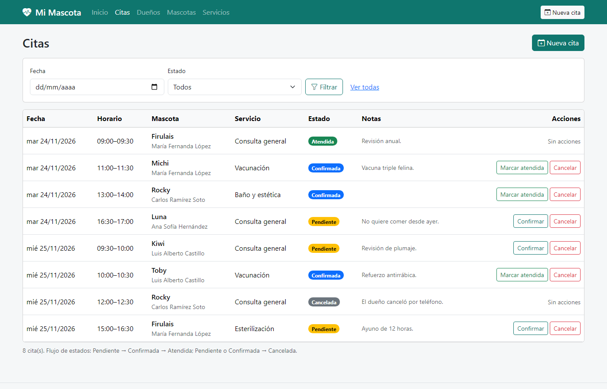
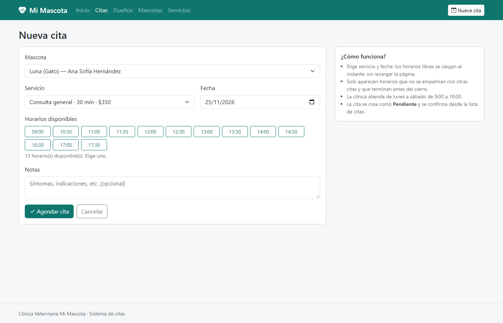
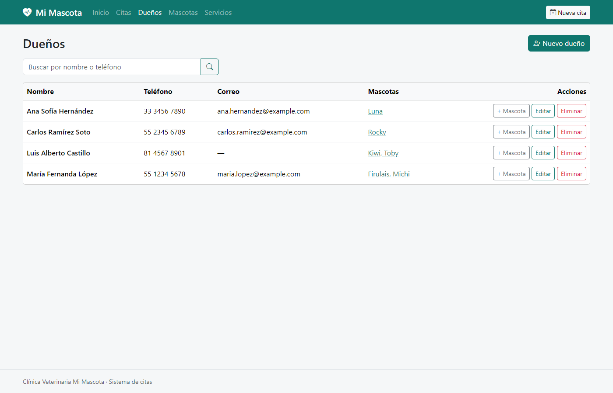
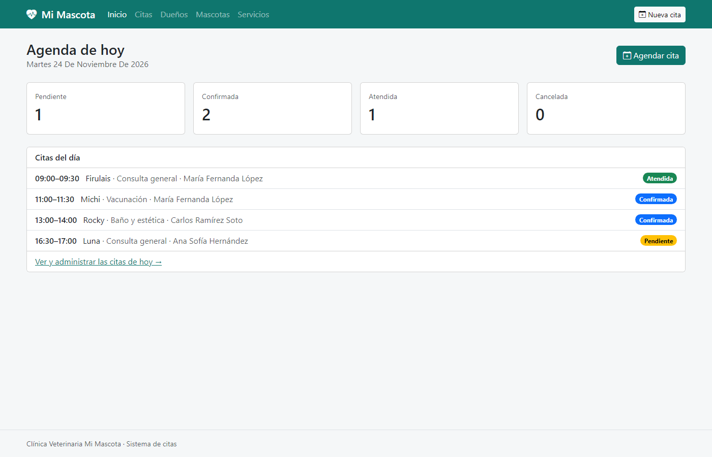

# Mi Mascota · Veterinary appointment booking


Appointment booking system for a small veterinary clinic, **Mi Mascota**. Staff register pet owners and their pets, keep a catalog of services, and book appointments on a calendar grid that only offers free time slots. Each appointment then moves through a controlled workflow: **Pendiente → Confirmada → Atendida**, or **Cancelada**.

**Stack:** C# · ASP.NET Core 9 MVC (Razor views) · Entity Framework Core 9 · SQL Server (SQLite for local runs) · Bootstrap 5 · jQuery/AJAX · xUnit

The UI is in Spanish (the clinic's language). The code is in English.

## Features

- **Owners, pets and services**: CRUD with server-side and client-side validation. Records that are still in use can't be deleted (an owner with pets, a pet or service with appointments); the app explains why.
- **Appointments**: list filtered by date and status, plus one button for each status the appointment can move to next.
- **Dynamic availability**: in the booking form, choosing a service and a date calls `GET /Appointments/Availability` with jQuery AJAX. The free slots come back as JSON and are drawn as buttons, with no page reload.
- **Double-booking protection**: the server checks the slot again before saving. If it overlaps another appointment, the form shows a descriptive message, e.g. *"El horario 12:30–13:30 ya está ocupado: se empalma con la cita de Rocky (Baño y estética, 13:00–14:00)."*
- **Controlled state changes**: invalid transitions are rejected with a Spanish message that explains why.
- **Demo data**: 4 owners, 6 pets, 4 services and 8 appointments on today and the next open day.

## Screenshots

| Appointments | New appointment (slots loaded via AJAX) |
|---|---|
|  |  |

| Owners | Dashboard |
|---|---|
|  |  |

## Domain rules

### Appointment state machine

| From \ To      | Pendiente | Confirmada | Atendida | Cancelada |
|----------------|:---------:|:----------:|:--------:|:---------:|
| **Pendiente**  | –         | ✅ ¹       | ❌       | ✅        |
| **Confirmada** | ❌        | –          | ✅       | ✅        |
| **Atendida**   | ❌        | ❌         | –        | ❌        |
| **Cancelada**  | ❌        | ❌         | ❌       | –         |

¹ An appointment whose start time has already passed can't be confirmed.

New appointments always start as **Pendiente**. *Atendida* and *Cancelada* are final states. Every rejected change returns a specific message, for example:

- Pendiente → Atendida: *"No se puede marcar como atendida una cita pendiente: primero debe confirmarse."*
- Atendida → anything: *"La cita ya fue atendida; su estado ya no puede cambiar."*
- Cancelada → anything: *"La cita está cancelada; su estado ya no puede cambiar…"*

The rules live in a single place, [`AppointmentStateMachine`](src/MiMascota.Web/Services/AppointmentStateMachine.cs). The service uses it to validate a change, and the list view uses it to decide which buttons to show.

### Availability and booking rules

| Rule | Detail |
|---|---|
| Opening hours | 09:00–18:00, Monday to Saturday (configurable) |
| Grid | Appointments start every 30 minutes (configurable) |
| Duration | Each service has its own duration. A slot is only offered if the whole service ends by closing time (a 90-minute service's last slot is 16:30). |
| Overlaps | One consultation room: no two active appointments can overlap. Two ranges overlap when `a.Start < b.End && a.End > b.Start`, so back-to-back appointments are allowed. |
| Cancelled | A cancelled appointment frees its slot. |
| Closed days | Sundays return *"La clínica no abre los domingos."* |
| Past | No past dates, and on the current day no slot that has already started. |

The hours are set in `appsettings.json`:

```json
"Clinic": {
  "OpeningTime": "09:00",
  "ClosingTime": "18:00",
  "SlotMinutes": 30,
  "ClosedDays": [ "Sunday" ]
}
```

## Architecture

```
Browser (Razor views + Bootstrap + jQuery)
        │  HTTP / AJAX (JSON)
        ▼
Controllers ── thin: bind input, call a service, choose a view/redirect
        │
        ▼
Services ──── business rules, return Result / Result<T> (no exceptions for rule violations)
  ├─ AvailabilityService   free slots for a date + service
  ├─ AppointmentService    booking with overlap check, status changes
  ├─ AppointmentStateMachine  allowed transitions + Spanish messages
  └─ ClinicSchedule        opening hours, closed days, slot grid (pure logic)
        │
        ▼
EF Core (AppDbContext) ── SQL Server (migrations) or SQLite (EnsureCreated)
```

```
src/MiMascota.Web/
  Controllers/   Home, Appointments, Owners, Pets, Services
  Services/      Result, ClinicSchedule, AvailabilityService, AppointmentService, AppointmentStateMachine
  Models/        Owner, Pet, VetService, Appointment, AppointmentStatus (+ Spanish display names)
  ViewModels/    Form and list models for the views
  Data/          AppDbContext, SeedData, DatabaseSetup, Migrations (SQL Server)
  Views/         Razor views (Spanish UI)
  wwwroot/js/    appointment-create.js (AJAX availability)
tests/MiMascota.Tests/
  AvailabilityServiceTests, AppointmentServiceTests, WebIntegrationTests
```

Design decisions:

- **Business errors are values, not exceptions.** `AppointmentService.CreateAsync` returns `Result<Appointment>`. The controller either redirects or adds the message to `ModelState` and shows the form again.
- **The end time is stored.** `End` is calculated once from the service duration when the appointment is booked. Overlap checks are then a plain SQL query, and changing a service's duration later doesn't move existing appointments.
- **Time is injected.** The services use `TimeProvider`, so tests can freeze "now" to check the "no past slots" and "can't confirm in the past" rules.
- **CRUD controllers use the `DbContext` directly.** Owners, pets and services have no business rules beyond validation, so an extra layer would only add indirection. Everything about booking goes through the services.

## Running locally

Requirements: [.NET 9 SDK](https://dotnet.microsoft.com/download).

### Option 1: SQLite (zero setup)

```bash
cd src/MiMascota.Web
dotnet run
```

Open http://localhost:5080. In Development, `appsettings.Development.json` sets `Database:Provider = "Sqlite"`. The app creates `mimascota.db` with `EnsureCreated()` and loads the demo data. To start from scratch, delete `mimascota.db`.

### Option 2: SQL Server

`appsettings.json` uses the SQL Server provider with a placeholder password. Supply the real connection string through an environment variable (or `dotnet user-secrets`). Never commit it.

```bash
# PowerShell: $env:ConnectionStrings__SqlServer = "..."
export Database__Provider=SqlServer
export ConnectionStrings__SqlServer="Server=localhost,1433;Database=MiMascota;User Id=sa;Password=<your-password>;TrustServerCertificate=True"
cd src/MiMascota.Web
dotnet run
```

On startup the app applies the EF Core migrations in `Data/Migrations` (`Database.Migrate()`) and seeds the demo data if the database is empty.

**Database approach:** SQL Server is the "real" database and is versioned with **migrations**. SQLite is only for quick local runs and tests, so it uses `EnsureCreated()` from the same model. Migrations are always generated for SQL Server through `DesignTimeDbContextFactory`:

```bash
dotnet ef migrations add <Name> --project src/MiMascota.Web -o Data/Migrations
```

### Option 3: Docker

```bash
# App + SQL Server 2022 (create a .env file with MSSQL_SA_PASSWORD=YourStrong!Passw0rd first)
docker compose up --build
# → http://localhost:8080

# Or only the app, with SQLite inside the container
docker build -t mi-mascota .
docker run -p 8080:8080 -e Database__Provider=Sqlite mi-mascota
```

## Tests

```bash
dotnet test
```

48 test cases (28 test methods) with xUnit:

- **AvailabilityServiceTests**: SQLite in-memory database and a fixed clock. Covers the 30-minute grid, durations of 60/90 minutes, overlaps, cancelled appointments freeing slots, Sundays, past dates, no past slots today, unknown service, and hours read from configuration.
- **AppointmentServiceTests**: covers booking (end time, overlap rejection for exact, partial-start and partial-end overlaps, back-to-back, re-using a cancelled slot, schedule violations) and every valid and invalid status transition (4 + 12 cases). Also checks that an appointment can't be confirmed in the past.
- **WebIntegrationTests**: `WebApplicationFactory` with a temporary SQLite file. Checks that every page renders, that the availability endpoint returns JSON slots or the closed-day message, that posting an overlapping appointment re-renders the form with the error, that a valid post redirects, and that a status change without an antiforgery token is rejected.

CI (GitHub Actions) runs the same command on every push and pull request.

---

Author: **Jovany Morales del Ángel** · MIT License
